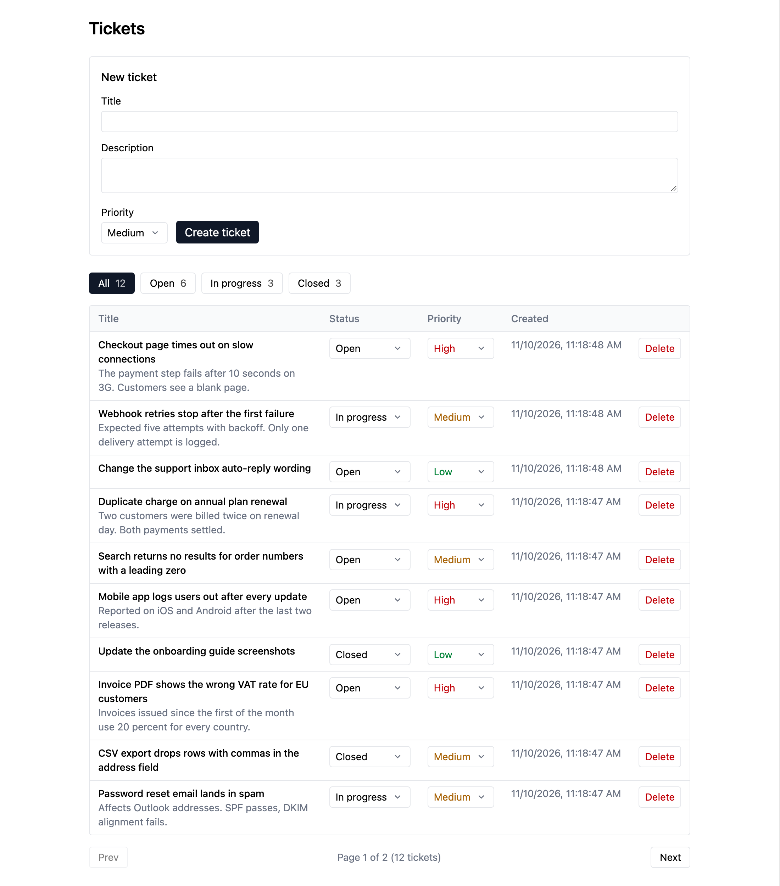

# Support Ticket Tracker

[](https://github.com/jnicolao/support-ticket-tracker/actions/workflows/ci.yml)

A ticket tracker for a small support team: create tickets, triage them by status and priority, filter the queue, and open any ticket for its full details. It is an Express and PostgreSQL REST API with a Next.js UI, covered by integration tests that run against a real database.



## Features

- **Create tickets** with a title, description and priority. Validation errors come from the API and appear next to the field they belong to. After a create the list returns to page 1 so the new ticket is visible.
- **Triage in the table.** Each row has a status select and a priority select. Either one saves on change and then refetches the current page.
- **Filter by status.** Four buttons (All, Open, In progress, Closed) filter the list, and each one shows its live ticket count. An empty result names the active filter.
- **Ticket detail page.** A ticket's title links to `/tickets/:id` with the full description, status, priority, and the created and updated times. In the table, a long description is cut to two lines.
- **Delete tickets** behind a confirmation prompt.
- **Pagination** at 10 tickets per page, newest first. If a delete or a status change empties the current page, the list steps back to the last page that has tickets.
- **Accessible by default.** Every control has a label, errors are announced, and the table scrolls sideways on small screens instead of breaking the layout.

## Stack

| Part | Tools |
|---|---|
| API | Node.js, Express 5, TypeScript, `pg` with plain parameterized SQL, zod |
| Database | PostgreSQL 17, numbered SQL migrations |
| UI | Next.js 16 App Router, React 19, Tailwind CSS 4 |
| Tests and CI | Vitest, Supertest, GitHub Actions |

## Project layout

```
api/    Express + TypeScript API: src/ (app), db/migrations/ (numbered SQL), tests/ (integration tests)
web/    Next.js + Tailwind UI
db/     Compose init script that creates the test database
docs/   README screenshot
```

The API and the UI are two independent npm packages with no workspace or shared package between them.

## Prerequisites

- Node.js 22 or newer
- Docker with Compose, for PostgreSQL

## Run it

Start PostgreSQL. The first start of the volume also creates the `tickets` and `tickets_test` databases.

```bash
docker compose up -d --wait
```

Start the API on http://localhost:3001. The env file holds `DATABASE_URL` and `PORT`. The migrate script applies the numbered SQL files in `api/db/migrations` that are not yet recorded in the `schema_migrations` table, each in its own transaction, so it is safe to run again at any time.

```bash
cd api
npm install
cp .env.example .env
npm run db:migrate
npm run dev
```

In a second terminal, start the UI on http://localhost:3000:

```bash
cd web
npm install
npm run dev
```

The UI calls the API at `http://localhost:3001`. Set `NEXT_PUBLIC_API_URL` to change that (see `web/.env.example`). To start from an empty database, run `docker compose down -v` and the steps above again.

## API

| Method | Path | Description |
|---|---|---|
| POST | `/tickets` | Create a ticket. Body: `title` (required, trimmed, max 200 chars), `description` (optional, blank stored as null), `priority` (`low`, `medium`, `high`; default `medium`). Status cannot be set; new tickets start `open`. Returns 201 with the ticket. |
| GET | `/tickets` | List tickets ordered by `created_at` then `id`, newest first. Query: `status`, `page` (integer, default 1), `limit` (integer 1 to 100, default 20). Returns `{ data, pagination: { page, limit, total, totalPages } }`. A page past the end returns an empty `data` with 200; `totalPages` is 0 when there are no tickets. |
| GET | `/tickets/:id` | One ticket. Returns 200 with the ticket, 400 for a non-integer id, 404 for an unknown id. |
| PATCH | `/tickets/:id` | Update `status` (`open`, `in_progress`, `closed`) and/or `priority`. The body must contain at least one of them and nothing else. Returns 200 with the updated ticket, 400 for a non-integer id, 404 for an unknown id. |
| DELETE | `/tickets/:id` | Delete a ticket permanently. Returns 204 with no body, 400 for a non-integer id, 404 for an unknown id. |
| GET | `/tickets/stats` | Count of tickets per status as numbers, always including all three statuses. |

Every ticket carries `created_at` and `updated_at`. A database trigger sets `updated_at` on every UPDATE, so no code path can forget it; on a new ticket the two are equal.

Every error has the same shape: `{ "error": { "message": "...", "details": [...] } }`. `details` lists each invalid field with a `path` and a `message` when validation fails. Unknown body fields are rejected with 400; unknown query parameters are ignored. Malformed JSON and unknown routes use the same shape, and unexpected errors return a generic 500 message with no stack trace.

Create a ticket:

```bash
curl -X POST localhost:3001/tickets -H 'Content-Type: application/json' -d '{"title":"Printer jammed","priority":"high"}'
```

Response: `201 {"id":1,"title":"Printer jammed","description":null,"status":"open","priority":"high","created_at":"2026-10-13T08:00:00.000Z","updated_at":"2026-10-13T08:00:00.000Z"}`

List open tickets, five per page:

```bash
curl 'localhost:3001/tickets?status=open&page=1&limit=5'
```

Response: `200 {"data":[...],"pagination":{"page":1,"limit":5,"total":1,"totalPages":1}}`

Close it:

```bash
curl -X PATCH localhost:3001/tickets/1 -H 'Content-Type: application/json' -d '{"status":"closed"}'
```

Send something invalid:

```bash
curl -X POST localhost:3001/tickets -H 'Content-Type: application/json' -d '{"title":""}'
```

Response: `400 {"error":{"message":"Validation failed","details":[{"path":"title","message":"Title is required"}]}}`

## Tests

The tests are integration tests: Supertest drives the Express app against the real `tickets_test` database, which is truncated before every test. PostgreSQL must be running. The setup refuses to run against any database whose name does not end in `_test`, and `TEST_DATABASE_URL` overrides the default connection string.

```bash
cd api
npm test
```

The 28 tests cover:

- `create.test.ts`: defaults applied and row persisted, description and priority stored, and five invalid bodies (missing, blank and overlong title, bad priority, unknown field) rejected with the error shape
- `list.test.ts`: status filter, page size, total, newest-first order, a page past the end, the unfiltered defaults, and five invalid query values rejected
- `get.test.ts`: one ticket returned by id, a non-integer id rejected, unknown id returns 404
- `update.test.ts`: status and priority updated independently and persisted, `updated_at` advances, four invalid inputs rejected, unknown id returns 404
- `delete.test.ts`: the ticket is removed and others are left alone, a non-integer id rejected, unknown id returns 404
- `stats.test.ts`: every status present with zeros, counts reflect a PATCH, values are numbers
- `errors.test.ts`: malformed JSON returns 400 in the standard shape
- `migrations.test.ts`: every migration file is recorded exactly once and a second run applies nothing

The UI has no automated tests; `npm run lint` in `web/` runs ESLint with the Next.js and React Hooks rules.

## Design decisions

- **Plain SQL over an ORM.** The API runs a handful of queries through `pg`. They stay readable and easy to reason about, and an ORM would add more than it removes.
- **Text columns with CHECK constraints, not Postgres enums.** Adding a status or priority is a one-line constraint change instead of an enum migration. The allowed values live in one array that validation and the tests share, and the UI keeps its own copy instead of adding monorepo tooling.
- **Strict validation with zod.** Unknown body fields and bad query values get a 400 instead of being silently dropped or clamped.
- **Numbered SQL migrations.** A small script applies each file in order inside a transaction and records it in a `schema_migrations` table, which covers this project without a migration library.
- **`updated_at` is set by a database trigger**, so no code path can forget it.
- **Offset pagination.** It is simple and the UI needs page numbers. Cursor pagination would be the upgrade for large tables or for stable pages while tickets are being created.
- **PATCH is one UPDATE with COALESCE and RETURNING.** Concurrent updates are serialized by the row lock and the last write wins per field, with no read-then-write race.
- **Integration tests against a real database.** The test files run one at a time because they share it.
- **Refetch after every change, no optimistic updates.** This keeps the UI state logic small at the cost of a round trip.
- **CI on every pull request.** It runs the API tests against a Postgres service and lints, typechecks and builds the UI.

## Behavior and limits

- Any status can move to any other status; there is no workflow enforcement.
- Status cannot be set on create; every ticket starts open.
- Title and description are trimmed, and a blank description is stored as null.
- Deleting a ticket is permanent; there is no soft delete.
- The UI shows 10 tickets per page while the API defaults to 20.
- Ticket ids are integers; a non-integer or out-of-range id is a 400 and an unknown id is a 404.
- The list's count and page queries are not wrapped in a transaction, so `total` can be off by one if a ticket is created between them. The next refetch corrects it.
- Timestamps are returned as UTC ISO 8601 strings; the UI shows them in the browser's local time.
- There are no user accounts. The API allows any origin and has no auth, so anyone who can reach it can change any ticket.

## Possible next steps

- User accounts, with tickets assigned to people
- A status history per ticket
- Editing a ticket's title and description
- A browser-level end-to-end test for the create, triage and delete flow
